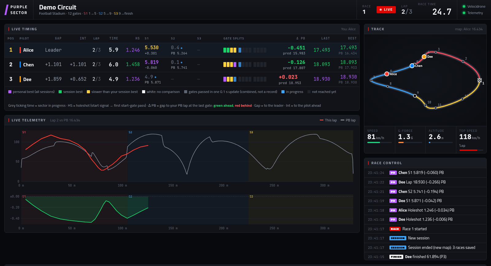
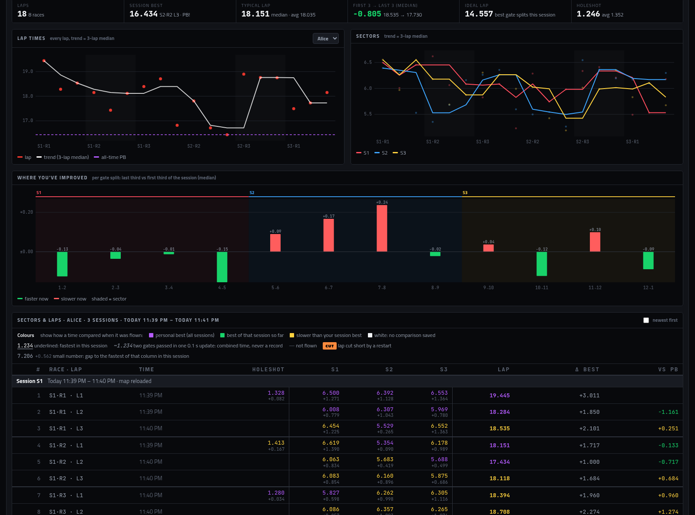
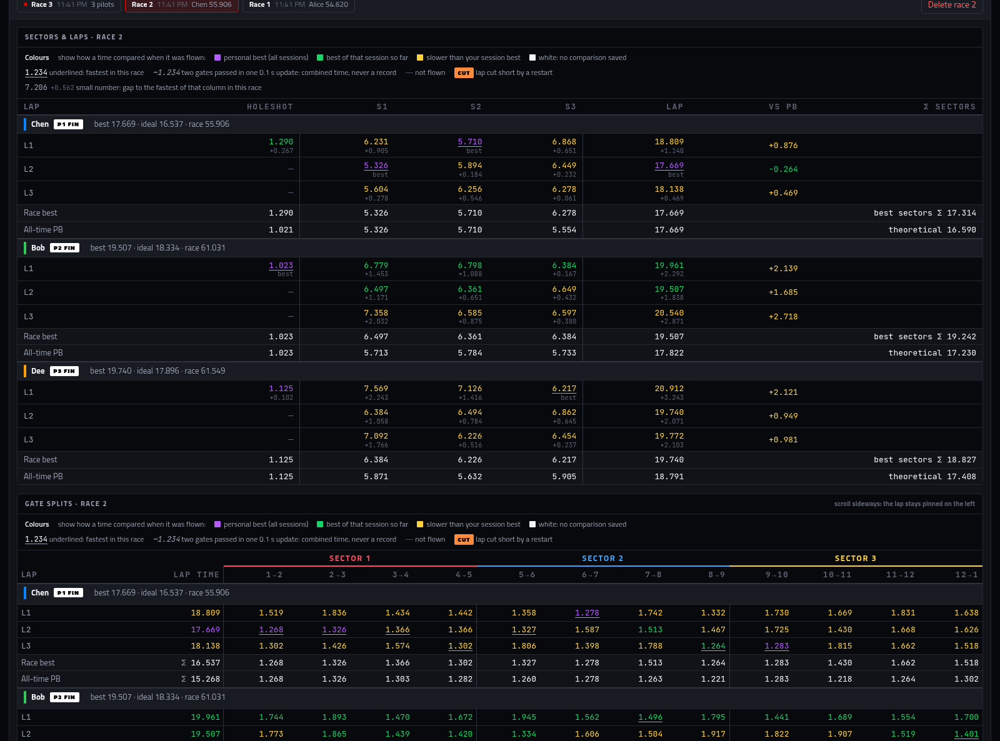

# PurpleSector

**F1-style live timing and race analysis for [Velocidrone](https://www.velocidrone.com).**

PurpleSector times every lap gate by gate (holeshot, every gate split, three sectors, lap and race
time) and keeps each pilot's bests per track. A returning pilot is always racing their own previous
times. With the game's IMU feed on, it also draws a live track map with speed, G-force and a running
delta to your best lap. The name comes from F1, where a purple sector is the fastest ever, and that's
the colour your personal bests show here.

It runs next to the game and reads Velocidrone's built-in race WebSocket (the same feed FPVTrackside
uses). Nothing in the game is modified. Everything is stored on your own PC.



## Features

- **Live timing tower:** position, gap and interval, running lap and sector clocks, holeshot,
  S1/S2/S3, a block for every gate split, live Δ to your PB lap with a predicted lap time, last and
  best lap.
- **Session view:** every lap of your session (across all its races) in one list, with each sector's
  gap to the session best and trend charts that show whether you're improving.
- **Gate splits:** every gate-to-gate time per lap, grouped by sector, with the lap pinned while you
  scroll on big tracks.
- **Race analysis:** classification, lap-time chart, race trace, positions, lap comparison, time lost
  per gate, consistency.
- **Telemetry** (WebSocket IMU on): live track map, speed / G / altitude, speed trace and time delta
  against your PB lap, and lap-vs-lap comparison afterwards.
- **History:** sessions are saved automatically and can be reloaded (one or several at once) from the
  Session menu. A **Data** tab lets you delete what you don't need.

| Session | Gate splits |
| --- | --- |
|  |  |

## Quick start

1. Install [Node.js](https://nodejs.org) (the LTS version). No `npm install` is needed: there are no
   dependencies. Node 18 works. Node 22.13 or newer also lets the timer read the track name from the
   game's settings.
2. In Velocidrone, open **Main Settings** and turn on **WebSocket**. Turn on **WebSocket IMU** too if
   you want the map, speed, G-force and telemetry charts.
3. Start the timer:
   - **Windows:** double-click `start.bat`. It opens the page in your browser.
   - **Linux / macOS:** run `./start.sh`. It opens the page in your browser (or run `npm start` and
     open <http://127.0.0.1:8090>).
4. Fly. Leave the timer window open while you race, and close it (or press Ctrl+C) to stop.

## Using it

### Colours

Every table uses the same colours, judged at the moment a time was flown:

| | |
| --- | --- |
| **purple** | personal best across all your sessions |
| **green** | your best of that session so far (not an all-time PB) |
| **yellow** | slower than your best of that session |
| **white** | no comparison saved |

**Underlined** is the fastest in that race (Gate splits) or session (Session). On the Records tab it
marks the track record in each column. `~1.234` in grey italics means two gates were passed inside one
0.1 s update, so only their combined time is known and it never counts as a record. **cut** marks a lap
cut short by a restart, or by the game flagging a finish partway round the lap (shown as **Early finish**). All times are in plain seconds (a 3-lap race reads 86.795).

### Sessions

Every timer start, and every map you load, begins a fresh session. A session is closed and saved when:

- you load a map
- you change track in the game
- you return to the menu (about a minute without telemetry or race data; needs WebSocket IMU)
- you close the game (the connection stays down for 15 s)
- you stop the timer

Use the **Session** menu to load earlier sessions, grouped by map and day, alone or together.
**Current only** goes back to the live one.

### Tabs

- **Session:** the *Sectors & laps* card (holeshot, S1–S3, lap; each with its gap to the session best),
  the *Gate splits* card, lap-time and sector trend charts (median over one race's worth of laps, so a
  crash lap doesn't skew it), and *Where you've improved* (each gate split, last third of the session
  vs the first).
- **Race analysis / Gate splits / Telemetry:** one race at a time, picked from the race list.
- **Records:** all-time bests per track: holeshot, sectors, theoretical lap (best sectors), ultimate
  lap (best gate splits), best lap, and a best-split table.
- **Track:** the map coloured by sector, gate owner or speed. Rename, merge, re-learn gates or delete a
  track.
- **Data:** delete sessions (or just their telemetry), tracks or pilots' records, and see how much
  space they use. *Rebuild from saved races* recalculates a track's records after you delete bad
  data.

## How it works

- **Sectors:** the gates (start/finish included) are counted and split into thirds. On a 12-gate track,
  S1 runs to gate 5, S2 to gate 9 and S3 to the finish. The gate count is learned on the first lap of
  a new track and confirmed when someone finishes.
- **Times** are the game's own race-clock times for each gate, sent from each pilot's client, so
  network lag doesn't affect them. The game reports progress every 0.1 s.
- **Holeshot** is the time from the start signal to the first pass through the start gate.
- **Races:** a new race starts with the game's start signal, or when a pilot starts lap 1 again. If
  you restart mid-race, everything flown so far is kept and the race is marked "Restarted on lap N".
  Once a pilot crosses the finish line, nothing more is recorded for them until the next race.
- **Pilots** are matched by name (case-insensitive). Records are kept per track.
- **Track names:**
  - The game only announces the track when a map is loaded. The timer also reads the selected track
    from the game's settings (read-only, Node 22.13+), so it usually knows the track even if started
    late.
  - A track is only shown while you're actually on a map.
  - If no name is available, records go to "Unnamed track (N gates)". Fold them into the right track
    with **Merge** on the Track tab.
- **Telemetry** comes from the game's IMU stream. It only covers the drone flown on the PC running the
  game, so other pilots' map positions are estimated from their last gate.

## Your data

- Records and race history: `data/sectors.json`, backed up to `data/sectors.json.bak` every time the
  timer starts. Telemetry: `data/telemetry/race-<id>.json`. The last 500 races are kept.
- To back up or move your records, copy the `data` folder.
- The timer only talks to the game on your PC or network. The web page also loads two fonts from
  Google Fonts; without internet it falls back to system fonts.
- The page is served to this PC only. `--host 0.0.0.0` makes it reachable from your local network,
  where anyone on it can view it but not change or delete anything (see `--allow-remote-edit`).

## Troubleshooting

- **"Waiting for Velocidrone":**
  - Check that **WebSocket** is on in Main Settings and the game is running.
  - The game allows only **one** WebSocket client at a time, so close FPVTrackside or any other tool
    using it.
  - If the game runs on another PC, pass `--velocidrone ws://THAT-PC-IP:60003/velocidrone`.
- **"Unnamed track":** the timer didn't hear the track name. Start the timer before loading the map,
  use Node 22.13+ so it can read the game's settings, or merge the track on the Track tab.
- **No map, speed or G-force:** turn on **WebSocket IMU** in the game's Main Settings, then fly a full
  lap.
- **Nothing recorded for a lap:** a pilot first seen mid-lap (timer started mid-race) is timed from
  their next lap.
- **Troubleshooting data:** run with `--log data/raw.jsonl` to save every message from the game.

## Command-line options

```
--velocidrone ws://HOST:60003/velocidrone   game address (default: this PC, tried on localhost and LAN IPs)
--port 8090                                  web page port
--host 0.0.0.0                               serve the page to other devices on your network (default: this PC only)
--allow-remote-edit                          with --host: also allow edits/deletes from other devices
--open                                       open the page in your browser once the timer is running
--data path/to/sectors.json                  records file (default: data/sectors.json)
--log path/to/raw.jsonl                      record every raw message from the game (troubleshooting)
--game-data DIR                              the game's settings folder, if not in the default place
--no-game-data                               don't read the track name from the game's settings
```

## Development

No build step and no dependencies: plain Node (ES modules) and a static page.

```sh
npm test       # engine unit tests + end-to-end test against a simulated Velocidrone feed
npm run demo   # live demo with simulated races (and IMU) at http://127.0.0.1:8091
```

| File | What it does |
| --- | --- |
| `sector-timer.mjs` | CLI, web server (SSE + JSON API), game connection, saving |
| `engine.mjs` | timing logic: laps, gate splits, sectors, records, races, sessions |
| `telemetry.mjs` | IMU stream → live telemetry and per-lap traces |
| `gamedb.mjs` | reads the selected track from the game's settings (read-only) |
| `vd-socket.mjs` | minimal WebSocket client (the game needs exact header casing) |
| `public/` | the dashboard (`app.js`, `charts.js`, `style.css`) |
| `test/` | simulator, fake game server, tests and demo |

The message format the game sends is documented at the top of `engine.mjs`.

## License

[MIT](LICENSE) © d0t1q

## Disclaimer

This is an unofficial fan project. It is not affiliated with or endorsed by the makers of Velocidrone.
"Velocidrone" is used only to describe what this tool works with.
